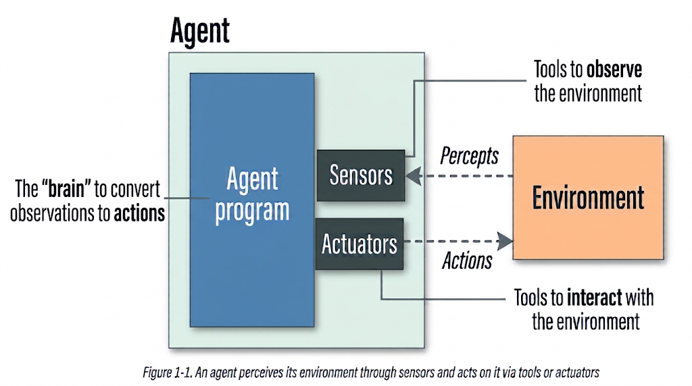

::: {.lesson-meta}
- **Level:** Foundations.
- **Active time:** 25–35 minutes.
- **Prerequisites:** Know how to run a Python cell in Colab or Jupyter. No model key is needed.
- **Outcome:** Describe the basic parts of an agent, explain FreeCampusAgent's methods, and run its first task.
- **Evidence:** The agent-parts diagram, the class definition, the returned message, and an explanation of why it does not answer the task yet.
- **Environment:** Google Colab or Jupyter with Python 3.10+; no GPU or internet connection is required.
:::

::: {.callout-note}
## Review draft
This is a proposed replacement for Unit 1, Lesson 1. It is for review, not a
released course activity. It introduces the agent/environment model that later
lessons use to study loops, task contracts, and architecture choices.
:::



## 1. What is an agent?

Russell and Norvig describe an agent as something that observes its surroundings
and acts on them ([*Artificial Intelligence: A Modern Approach*, Chapter 2](https://aima.cs.berkeley.edu/)).
The surroundings are the **environment**. An agent gathers information about
that environment, uses an **agent program** to decide what to do, and acts on
the environment.

| Part | Meaning |
|---|---|
| **Environment** | The world or situation the agent interacts with. |
| **Sensors** | The means by which the agent receives information about the environment. |
| **Actuators** | The means by which the agent acts on the environment. |
| **Agent program** | The rules or process that turns what the agent observes into an action. |

The figure below shows how these parts fit together.

{.lesson-visual}

*Source: Reproduced from Figure 1-1 in Maarten Grootendorst and Jay Alammar, [*An Illustrated Guide to AI Agents*, Chapter 1](https://learning.oreilly.com/library/view/an-illustrated-guide/9798341662681/ch01.html). The agent definition is credited to [Russell and Norvig, *Artificial Intelligence: A Modern Approach*, Chapter 2](https://aima.cs.berkeley.edu/).*

We will use this picture to make sense of a small Python class, then run the
class and see which parts it has—and which parts it does not have yet.

## 2. Meet FreeCampusAgent

Chapter 1 of *An Illustrated Guide to AI Agents* starts with a small class
called `TinyAgent`. The authors build on this starting structure in later
chapters. We will follow that approach and call our class **FreeCampusAgent**.

This first version is only a scaffold. It gives us a place to add parts later,
and a few methods that show how a task will move through the class. It does not
call a model or perform a real action yet.

```python
class FreeCampusAgent:
    """A minimal, modular, educational agent framework for the Agentic AI Engineering course of FreeCampus."""

    def __init__(self):
        self.llm = None      # Introduced in Unit 1, Lesson 2.
        self.memory = None   # Introduced in Unit 1, Lesson 3.
        self.tools = None    # Introduced in Unit 1, Lesson 4.
        self.planner = None  # Introduced in Unit 1, Lesson 5.

    def run(self, task: str) -> str:
        """Start the agent on a task."""
        return self._step(task)

    def _step(self, task: str) -> str:
        """Carry out one step of the agent."""
        # Placeholder: later lessons will add the decision process.
        return f"Received: {task}"

    def _execute_action(self, action: str) -> str:
        """Provide a place for action execution later."""
        # Placeholder: this does not run a real action yet.
        return f"Executed action: {action}"
```

## 3. What each method does

The four attributes in `__init__` are empty slots for capabilities we may add
later. A value of `None` means that capability is not connected in this version.

| Method or attribute | What it does in this scaffold |
|---|---|
| `__init__` | Runs when we create a new object. It sets up the four empty attributes. |
| `run(task)` | The entry point. It accepts a task and passes it to `_step`. |
| `_step(task)` | Represents one step of work. For now, it returns a message containing the task. |
| `_execute_action(action)` | Reserves a place for carrying out an action later. For now, it only returns placeholder text. |
| `llm`, `memory`, `tools`, `planner` | Names for possible future capabilities. None is active yet. |

The leading underscore in `_step` and `_execute_action` marks them as helper
methods. In this example, a learner starts work with `run`; the class uses
`_step` internally. `_execute_action` is not called by `run` yet.

## 4. Run FreeCampusAgent

Before running the cell, predict what it will return. Will it solve the math
problem, or tell us that it received the task?

```python
freecampus_agent = FreeCampusAgent()
print(freecampus_agent.run("What is 2 + 2?"))
```

The output is:

```text
Received: What is 2 + 2?
```

The result follows the methods in order: Python creates the object, `run`
passes the task to `_step`, and `_step` returns its placeholder message. It
does not calculate `4` because there is no model connected and no decision
process in `_step` yet. This is the same kind of first scaffold the book
introduces before adding more capable parts.

Try changing the task to `"What is an AI agent?"` and run the cell again. The
message should change to include your new task, but FreeCampusAgent still will
not answer it.

## 5. Where FreeCampusAgent fits in the picture

Now that we have seen the class and run it, we can compare it with the parts
in the figure:

| Part in the figure | In this first FreeCampusAgent scaffold |
|---|---|
| **Environment** | Not modeled yet. The task string is the only information we pass in. |
| **Sensors** | No separate sensor is built yet; `run(task)` receives the text directly. |
| **Actuators** | No real action is available. `_execute_action` is still a placeholder. |
| **Agent program** | The class methods provide the structure, but `_step` only echoes the task. |

The book treats its Chapter 1 class as scaffolding: it has not yet gained the
parts that let it behave as a capable agent. FreeCampusAgent is at that same
starting point. We will add and study capabilities as the course continues.

<script type="application/json" class="fcagentic-ojs-quiz-config">
{
  "id": "u01-separate-automation-workflows-and-agents-concept",
  "title": "Checkpoint: understand the class",
  "instructions": "Choose an answer, check the explanation, then select Next.",
  "questions": [
    {
      "id": "u01-separate-automation-workflows-and-agents-concept-1",
      "prompt": "What happens when Python creates FreeCampusAgent()?",
      "options": [
        "It sends a question to a language model.",
        "It sets up the class attributes with empty values.",
        "It runs a tool action.",
        "It saves the conversation for next time."
      ],
      "answer_index": 1,
      "explanation": "The constructor sets up llm, memory, tools, and planner as None. These are placeholders, not active features."
    },
    {
      "id": "u01-separate-automation-workflows-and-agents-concept-2",
      "prompt": "What does run(task) do in this version?",
      "options": [
        "It sends the task directly to the model.",
        "It executes an action from the task text.",
        "It passes the task to _step and returns that method's result.",
        "It stores the task in memory."
      ],
      "answer_index": 2,
      "explanation": "run is the entry point. It delegates the work to _step, which currently returns a placeholder message."
    },
    {
      "id": "u01-separate-automation-workflows-and-agents-concept-3",
      "prompt": "What do the llm, memory, tools, and planner attributes mean right now?",
      "options": [
        "They are empty placeholders for capabilities that are not connected yet.",
        "They are four tools that run automatically.",
        "They contain the student's last four questions.",
        "They are names for parts of the environment."
      ],
      "answer_index": 0,
      "explanation": "Each attribute is None. The names mark places where later lessons can add capabilities."
    }
  ]
}
</script>



<script type="application/json" class="fcagentic-ojs-quiz-config">
{
  "id": "u01-separate-automation-workflows-and-agents-evidence",
  "title": "Checkpoint: read the first run",
  "instructions": "Choose an answer, check the explanation, then select Next.",
  "questions": [
    {
      "id": "u01-separate-automation-workflows-and-agents-evidence-1",
      "prompt": "What text does the example print for the math task?",
      "options": [
        "4",
        "Executed action: What is 2 + 2?",
        "Received: What is 2 + 2?",
        "No output, because run returns None."
      ],
      "answer_index": 2,
      "explanation": "run passes the task to _step, and _step returns the Received message."
    },
    {
      "id": "u01-separate-automation-workflows-and-agents-evidence-2",
      "prompt": "Which method creates the Received: ... message?",
      "options": [
        "__init__",
        "_step",
        "_execute_action",
        "run"
      ],
      "answer_index": 1,
      "explanation": "_step contains the placeholder return statement that builds this message."
    },
    {
      "id": "u01-separate-automation-workflows-and-agents-evidence-3",
      "prompt": "Does run call _execute_action in this scaffold?",
      "options": [
        "Yes, for every task.",
        "Yes, but only when memory is empty.",
        "No. _execute_action is defined, but nothing calls it yet.",
        "No. The method is missing from the class."
      ],
      "answer_index": 2,
      "explanation": "The method exists as a placeholder, but run calls only _step."
    }
  ]
}
</script>



<script type="application/json" class="fcagentic-ojs-quiz-config">
{
  "id": "u01-separate-automation-workflows-and-agents-failure",
  "title": "Checkpoint: find unfinished behavior",
  "instructions": "Choose an answer, check the explanation, then select Next.",
  "questions": [
    {
      "id": "u01-separate-automation-workflows-and-agents-failure-1",
      "prompt": "Why does this run print an acknowledgement instead of 4?",
      "options": [
        "There is no model connected, and _step only returns a placeholder message.",
        "The task is too short for Python.",
        "The class has no run method.",
        "The task must be stored in memory first."
      ],
      "answer_index": 0,
      "explanation": "The class has no connected language model or decision process yet. Its current _step method returns a fixed acknowledgement."
    },
    {
      "id": "u01-separate-automation-workflows-and-agents-failure-2",
      "prompt": "If you call _execute_action(\"open a file\"), what happens now?",
      "options": [
        "Python opens the file.",
        "The model decides whether to open it.",
        "The method returns placeholder text; it does not open a file.",
        "The class raises an error because the method is missing."
      ],
      "answer_index": 2,
      "explanation": "The method is a placeholder. It returns a sentence and performs no real action."
    },
    {
      "id": "u01-separate-automation-workflows-and-agents-failure-3",
      "prompt": "How should we describe this first version?",
      "options": [
        "A finished agent that can answer general questions.",
        "A class scaffold with methods whose main behaviors are not built yet.",
        "A memory system with four saved conversations.",
        "A tool-running assistant connected to the course outline."
      ],
      "answer_index": 1,
      "explanation": "The class defines a structure, while its model, memory, tools, planning, and real actions are not connected yet."
    }
  ]
}
</script>



## 6. Explain the first run

Write three short sentences in your learning notes:

1. What happens when Python creates a `FreeCampusAgent` object?
2. Which method receives the task first, and which method returns the message?
3. Why does the class say it received the task instead of answering it?

**Key point:** This first class is a scaffold. `run` calls `_step`, and `_step`
returns a placeholder message. The model, memory, tools, planning, and real
actions have not been added yet.

The next lesson connects a language model to FreeCampusAgent. We will keep
building from this small starting point, adding one capability at a time.

### Sources

- Stuart Russell and Peter Norvig, [*Artificial Intelligence: A Modern Approach*, Chapter 2: “Intelligent Agents”](https://aima.cs.berkeley.edu/).
- Maarten Grootendorst and Jay Alammar, [*An Illustrated Guide to AI Agents*, Chapter 1](https://learning.oreilly.com/library/view/an-illustrated-guide/9798341662681/ch01.html), and the [pinned Chapter 1 notebook](https://github.com/HandsOnLLM/An-Illustrated-Guide-To-AI-Agents/blob/7f56242c4150df4c463210d8e6d9300988057b5e/chapter01/chapter01.ipynb). The class structure and first run follow that chapter's introductory scaffold.

**Want to learn more?** Consider getting *An Illustrated Guide to AI Agents* by
Maarten Grootendorst and Jay Alammar. The book explores agent concepts in greater
depth through illustrations and a step-by-step TinyAgent build.
