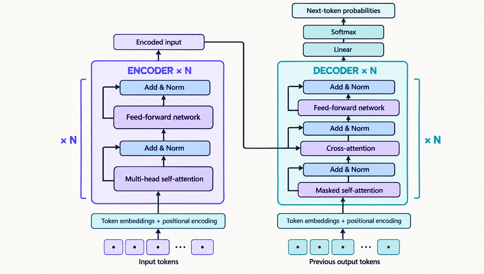
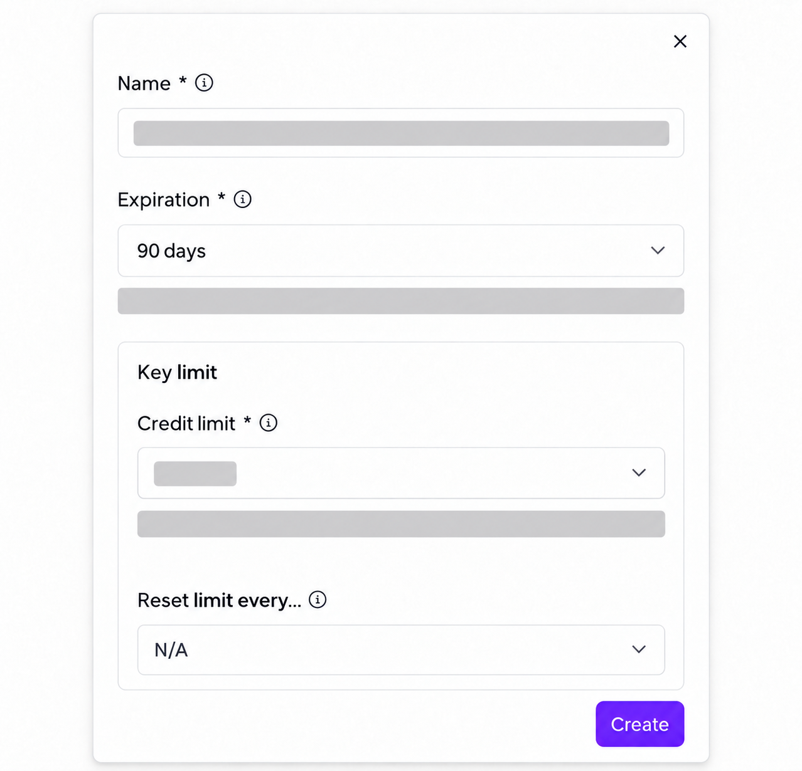
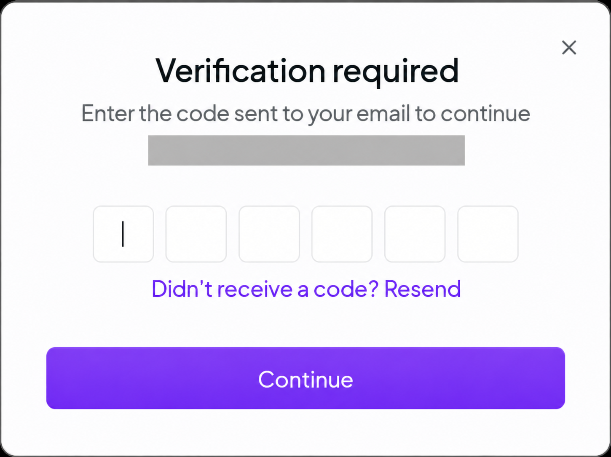
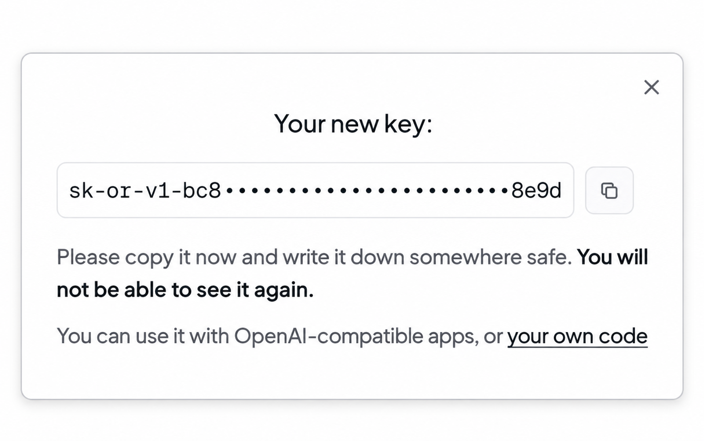
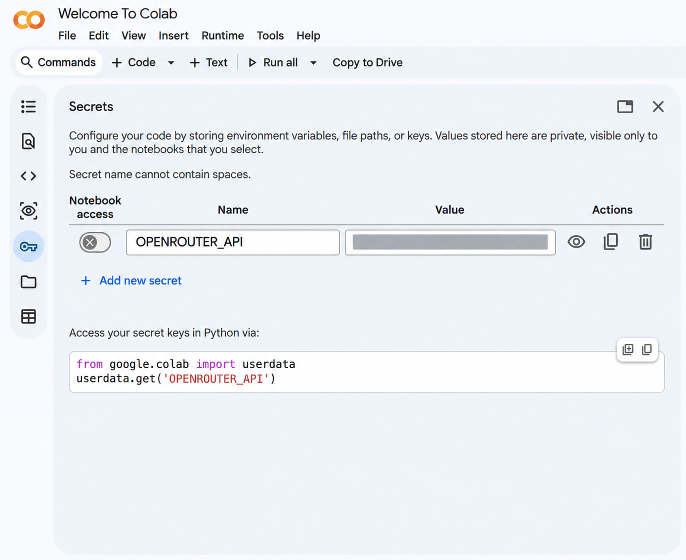

::: {.lesson-meta}
- **Level:** Introductory; no previous AI or agent knowledge required.
- **Active time:** 25–35 minutes.
- **Prerequisites:** Open a Colab notebook and run a Python cell.
- **Outcome:** Explain how an AI product, model, LLM, and Transformer differ; describe what an agent and harness do; and make one model call.
- **Evidence:** Vocabulary notes, the model ID, and the “Hello, world!” response.
- **Environment:** Google Colab, internet access, and an OpenRouter API key stored as a Colab secret.
:::

::: {.callout-note}
## Review draft
This lesson is awaiting independent teaching and accessibility review. The local
review build includes its notebook; a public Colab URL is not available yet.
:::



## 1. Models and familiar names

You may know **ChatGPT**, **Claude**, or **Gemini** as AI products. A product,
the company behind it, and the model it uses are related, but they are not the
same thing:

- A **developer or provider** builds or provides a model.
- A **product** is the app or service people use.
- A **model** is software that takes input and produces an output. A model ID
  names a specific model or version when you use an API.

| Developer or provider | Model family students may encounter |
|---|---|
| OpenAI | GPT |
| Anthropic | Claude |
| Google | Gemini |
| DeepSeek | DeepSeek |
| Alibaba | Qwen |
| Moonshot AI | Kimi |
| Zhipu AI | GLM |

Some names are used for both a model family and a product. **Claude** and
**Gemini** can mean either one. **ChatGPT** is a product; **GPT** is OpenAI's
model family. A product may let you choose which model to use. With an API,
check the model ID to see which model received your request.

DeepSeek, Qwen, Kimi, and GLM are model families developed in China. Students
will encounter them alongside OpenAI, Anthropic, and Google models. Different
models can work better for different tasks. Compare current versions and test
results instead of relying on one permanent ranking. Names and versions change,
so check each provider's current model list.

## 2. LLMs, GPT, and Transformers

A **large language model (LLM)** reads and creates text. It handles text as
small pieces called *tokens*, such as a word or part of a word. It predicts a
likely next token from the text so far, then repeats this step to create a
response. A fluent answer can still be wrong.

A **Transformer** is a kind of neural network: a computer system designed to
learn patterns. Its design is called an *architecture*. Many LLMs use the
Transformer architecture. Its *attention* step helps the model connect
information from different parts of its input. Transformer names a model
design, not an app or company.

{.lesson-visual}

*Simplified redraw adapted from Figure 1 in Vaswani et al. (2017), [“Attention Is All You Need”](https://arxiv.org/abs/1706.03762).*

**GPT** stands for *Generative Pre-trained Transformer*. GPT is OpenAI's model
family and one example of an LLM family. It is not another name for all LLMs.
Model families can differ, so check the documentation for the model you use.

## 3. Agents and harnesses

A model can answer one prompt without being an agent. An **agent** is software
that uses a model to work toward a goal. It may use tools, check their results,
and decide what to do next or when to stop. A model that only answers one prompt
is not, by itself, an agent.

A **harness** is the software that manages how the model works. It gives the
model the task and useful information, controls which tools it can use, checks
the model's requests, runs only allowed actions, and helps decide when the work
is done. The harness is one part of the agent; the agent is the whole system
doing the task.

{.lesson-visual}

**Farm analogy:** The horse is like the model: it provides the ability to do
work. The harness and reins are like the software harness: they connect and
guide that ability. The plough is a tool. The whole setup working toward the
goal is like the agent. The farmer represents the person who sets the task and
oversees it. In an AI system, code must enforce the harness's rules and limits.

### Five jobs a harness can do

| Part | What it does |
|---|---|
| **Loop** | Sends the model another request when the task needs more than one step. |
| **Tools** | Lets the model request actions, such as reading a file; the harness checks and runs allowed actions. |
| **Context** | Gives the model the task, instructions, available tools, and useful results so far. |
| **Memory** | Saves important progress so it can be used in later steps or sessions. |
| **Control** | Applies permissions and limits, asks for approval when needed, and stops the process when a limit is reached. |

Context is what the model sees for a step. Memory keeps useful information for
later. The model does not learn new facts or change its weights just because the
harness saves notes.

```text
Prepare task and context → model suggests a step
                         → harness checks permission
                         → allowed tool runs, if needed
                         → result returns to model
                         → continue or stop
```

Before an agent stops, its harness can ask it to compare its work with the task
and check the result. A harness can also notice repeated failed attempts and
prompt a new approach. Repeating nearly the same failed action is sometimes
called a *doom loop*.

Next, we will send one request to a model. That shows how to connect to a model;
it does not create an agent. The program will not choose and check a series of
steps toward a goal.

## 4. Connect to a model: “Hello, world!”

We will use OpenRouter's API to send one short request to a free model. An API
is a way for programs to communicate with a service. The free model option may
use a different model each time, so the cell prints the ID of the model that
answered. You need an API key and internet access, but no extra package or GPU.

### Add the key to Colab

1. Create an OpenRouter account if you do not have one. Open [API Keys](https://openrouter.ai/settings/keys) and choose **New Key**. Name the key. Choose an expiry date and spending limit you are comfortable with. The screenshot hides account-specific values.

   {.lesson-visual}

2. If OpenRouter asks you to verify your email, enter the code it sends you. The screenshot hides the email address.

   {.lesson-visual}

3. When OpenRouter shows the new key, copy the whole value. You will only see it once, so keep it private while you add it to Colab. The example below shows a key's shape: part of the start and end, with the middle hidden.

   {.lesson-visual}

4. In Colab, click the key-shaped **Secrets** icon in the left sidebar. Add a secret named `OPENROUTER_API`. Paste the key into its value field and turn on notebook access. The screenshot shows the matching name and code; its value is hidden.

   {.lesson-visual}

5. Keep the key in Secrets. Do not paste it into a code cell, notebook text, a prompt, or a shared document. Never publish or share a screenshot that shows the key.
6. OpenRouter's free models and request limits can change. For this exercise, keep the model set to `openrouter/free`; do not replace it with a paid model.

Use only the greeting shown below. Do not send personal or private information
to a model service.

### Make the request

Run this cell in Colab:

```python
import json
from urllib.request import Request, urlopen

try:
    from google.colab import userdata
except ModuleNotFoundError:
    userdata = None

if userdata is None:
    print("This live request uses Colab Secrets. Run this cell in Colab.")
else:
    api_key = userdata.get("OPENROUTER_API")
    if not api_key:
        raise RuntimeError("Add the OPENROUTER_API secret and allow notebook access.")

    payload = {
        "model": "openrouter/free",
        "messages": [
            {"role": "user", "content": "Reply with exactly: Hello, world!"}
        ],
        "max_tokens": 32,
    }
    request = Request(
        "https://openrouter.ai/api/v1/chat/completions",
        data=json.dumps(payload).encode("utf-8"),
        headers={
            "Authorization": f"Bearer {api_key}",
            "Content-Type": "application/json",
        },
        method="POST",
    )
    with urlopen(request, timeout=45) as response:
        result = json.load(response)

    print("Model:", result.get("model"))
    print("Response:", result["choices"][0]["message"]["content"])
```

The model ID may change because OpenRouter can use different free models.
Record the ID and the model's reply. You have sent a prompt to a language model
and received one response. You have not built an agent yet.

### Sources

- Maarten Grootendorst and Jay Alammar, [*An Illustrated Guide to AI Agents*, Chapter 1](https://learning.oreilly.com/library/view/an-illustrated-guide/9798341662681/ch01.html) introduces LLM-backed agents; [Chapter 2](https://learning.oreilly.com/library/view/an-illustrated-guide/9798341662681/ch02.html) introduces LLM and Transformer foundations. This lesson follows that progression and uses original examples. O’Reilly access may be required.
- Current model references: [OpenAI](https://platform.openai.com/docs/models), [Anthropic](https://docs.anthropic.com/en/docs/about-claude/models/overview), [Google Gemini](https://ai.google.dev/gemini-api/docs/models), [DeepSeek](https://api-docs.deepseek.com/api/list-models/), and [Alibaba Cloud Model Studio](https://www.alibabacloud.com/help/en/model-studio/models). Check these catalogs for current names and availability.
- OpenRouter, [Chat Completions API](https://openrouter.ai/docs/api/api-reference/chat/send-chat-completion-request), [free models](https://openrouter.ai/collections/free-models), and [pricing and limits](https://openrouter.ai/pricing/).

Model-family examples and provider references checked 2026-10-27.
